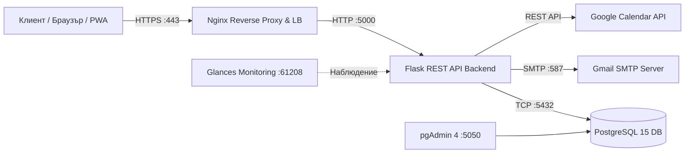

# Уеб и мобилна система за резервации и управление на салон за красота „Deni Style“

**Дисциплина:** Архитектурни модели за проектиране на софтуер  
**Продукционен адрес:** [https://denistyle.bg](https://denistyle.bg)

---

## 1. Описание на проекта
Проектът представлява реално действаща многослойна (Multi-tier) уеб и PWA (Progressive Web App) информационна система за автоматизирано управление на резервации, услуги, работен график и персонал за салон за красота **Deni Style**. 

Системата решава проблема със застъпването на часове чрез динамичен алгоритъм, който изчислява свободните слотове в реално време спрямо продължителността на избраната процедура, работното време на салона и индивидуалната заетост на всеки специалист.

---

## 2. Архитектурен модел и Компоненти (Docker Compose)
Решението е изцяло контейнеризирано и оркестрирано чрез **Docker Compose**, разделено на следните изолирани микросървиси/контейнери:

1. **`nginx` (Reverse Proxy & Load Balancer):** Приема входящия HTTP (порт 80) и криптиран HTTPS (порт 443) трафик чрез валиден SSL сертификат (Let's Encrypt) и пренасочва заявките към приложния сървър.
2. **`backend` (Уеб приложение и REST API):** Разработено на **Python 3.11** и микрофреймуърка **Flask**. Обработва бизнес логиката, сесиите, CRUD операциите и външните интеграции със **SMTP (Gmail)** за имейл известия и **Google Calendar API**.
3. **`db` (Релационна база данни):** **PostgreSQL 15**, отговаряща за съхранението на данните за служители, процедури и резервации с устойчив том (Docker Volume `pgdata`) и първоначална инициализация чрез `init.sql`.
4. **`pgadmin` (Управление на БД):** Уеб интерфейс (**pgAdmin 4** на порт 5050) за администриране и мониторинг на базата данни.
5. **`glances` (Система за наблюдение / Monitoring):** Уеб базиран инструмент за мониторинг в реално време на ресурсите на сървъра и контейнерите (CPU, RAM, дисково пространство, мрежов трафик) на порт 61208.

### Диаграма на архитектурните компоненти

    classDiagram
    class SalonConfig {
        +String salon_address
        +String salon_phone
        +String weekday_open
        +String weekday_close
        +String sat_open
        +String sat_close
        +String sun_open
        +String sun_close
        +load_config() Dict
        +save_config(data) void
    }

    class Staff {
        +int id
        +String name
        +String role
        +String email
        +String password
        +bool is_active
        +get_staff() List
        +add_staff(data) bool
        +delete_staff(staff_id) bool
        +login(username, password) Session
    }

    class Service {
        +int id
        +String name
        +int duration_minutes
        +String price
        +String category
        +String subcategory
        +String staff_role
        +get_services() List
        +add_service(data) bool
        +edit_service(service_id, data) bool
        +delete_service(service_id) bool
    }

    class Appointment {
        +int id
        +String client_name
        +String client_phone
        +int staff_id
        +int service_id
        +DateTime start_time
        +DateTime end_time
        +String status
        +get_schedule(staff_id, service_id, start_date) Dict
        +book_appointment(data) Response
        +cancel_appointment(app_id) Response
        +my_appointments(phone) List
        +get_appointments() List
    }

    class NotificationService {
        +String sender_email
        +String sender_password
        + bool google_api_available
        +send_email_notification(subject, text, receiver_email) void
        +add_to_google_calendar(summary, description, start_dt, end_dt, staff_email) void
    }

    Staff "1" --> "0..*" Appointment : изпълнява >
    Service "1" --> "0..*" Appointment : включва се в >
    Staff "1..*" o-- "0..*" Service : извършва (по роля) >
    Appointment "1" *-- "1" NotificationService : задейства >
    SalonConfig "1" ..> "0..*" Appointment : определя работно време за >

    ---
```

## 4. Реализирани CRUD операции и REST API Ендпойнти

| Метод | Маршрут (Endpoint) | CRUD Операция | Описание |
| :--- | :--- | :--- | :--- |
| `GET` | `/api/services` | **Read** | Извлича списък с всички услуги, цени, времетраене и категории. |
| `POST` | `/api/add_service` | **Create** | Добавя нова услуга в базата данни. |
| `PUT` | `/api/edit_service/<id>` | **Update** | Редактира съществуваща услуга (име, минути, цена, категория). |
| `DELETE`| `/api/delete_service/<id>`| **Delete** | Изтрива услуга и асоциираните записи от базата данни. |
| `GET` | `/api/staff` | **Read** | Извлича всички активни специалисти в салона. |
| `POST` | `/api/add_staff` | **Create** | Добавя нов служител с роля, имейл и парола за достъп. |
| `DELETE`| `/api/delete_staff/<id>` | **Delete** | Изтрива служител от системата. |
| `GET` | `/api/schedule` | **Read** | Изчислява свободните часове за 7 дни напред спрямо заетостта. |
| `POST` | `/api/book` | **Create** | Създава нова резервация, праща имейл и записва в Google Calendar. |
| `POST` | `/api/cancel` | **Update** | Променя статуса на резервацията на `cancelled` и уведомява екипа. |
| `POST` | `/admin/settings` | **Update** | Обновява конфигурацията за адрес, телефон и работно време. |