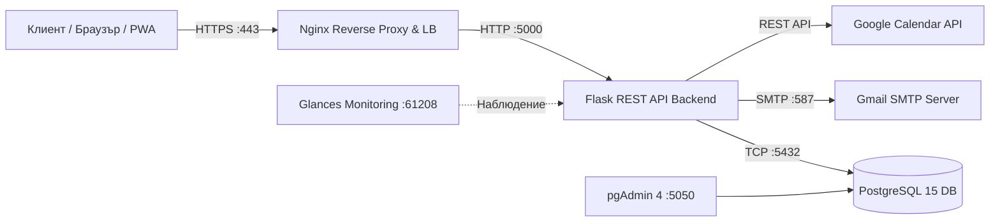
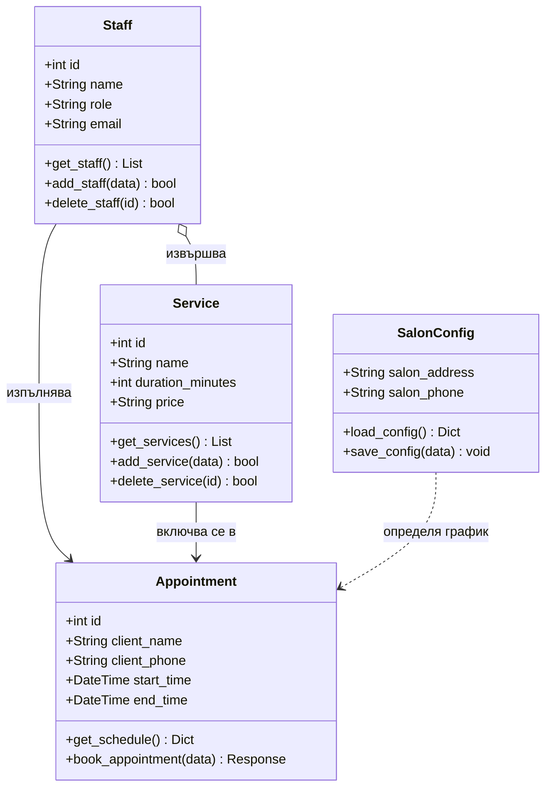

# Уеб и мобилна система за резервации и управление на салон за красота „Deni Style“

**Дисциплина:** Архитектурни модели за проектиране на софтуер  
**Продукционен адрес:** [https://denistyle.bg](https://denistyle.bg)

---

## 1. Описание на проекта
Проектът представлява реално действаща многослойна (Multi-tier) уеб и PWA (Progressive Web App) информационна система за автоматизирано управление на резервации, услуги, работен график и персонал за салон за красота **Deni Style**. 

Системата решава проблема със застъпването на часове чрез динамичен алгоритъм, който изчислява свободните слотове в реално време спрямо продължителността на избраната процедура, работното време на салона и индивидуалната заетост на всеки специалист.

---

## 2. Архитектурен модел и Компоненти (Docker Compose)
Решението е изцяло контейнеризирано и оркестрирано чрез **Docker Compose**, разделено на следните изолирани микросървиси/контейнери:

1. **`nginx` (Reverse Proxy & Load Balancer):** Приема входящия HTTP (порт 80) и криптиран HTTPS (порт 443) трафик чрез валиден SSL сертификат (Let's Encrypt) и пренасочва заявките към приложния сървър.
2. **`backend` (Уеб приложение и REST API):** Разработено на **Python 3.11** и микрофреймуърка **Flask**. Обработва бизнес логиката, сесиите, CRUD операциите и външните интеграции със **SMTP (Gmail)** за имейл известия и **Google Calendar API**.
3. **`db` (Релационна база данни):** **PostgreSQL 15**, отговаряща за съхранението на данните за служители, процедури и резервации с устойчив том (Docker Volume `pgdata`) и първоначална инициализация чрез `init.sql`.
4. **`pgadmin` (Управление на БД):** Уеб интерфейс (**pgAdmin 4** на порт 5050) за администриране и мониторинг на базата данни.
5. **`glances` (Система за наблюдение / Monitoring):** Уеб базиран инструмент за мониторинг в реално време на ресурсите на сървъра и контейнерите (CPU, RAM, дисково пространство, мрежов трафик) на порт 61208.

### Диаграма на архитектурните компоненти

## 3. UML Клас диаграма
Диаграмата представя основните класове и обекти в системата:

## 4. Реализирани CRUD операции и REST API Ендпойнти

| Метод | Маршрут (Endpoint) | CRUD Операция | Описание |
| :--- | :--- | :--- | :--- |
| `GET` | `/api/services` | **Read** | Извлича списък с всички услуги, цени, времетраене и категории. |
| `POST` | `/api/add_service` | **Create** | Добавя нова услуга в базата данни. |
| `PUT` | `/api/edit_service/<id>` | **Update** | Редактира съществуваща услуга (име, минути, цена, категория). |
| `DELETE`| `/api/delete_service/<id>`| **Delete** | Изтрива услуга и асоциираните записи от базата данни. |
| `GET` | `/api/staff` | **Read** | Извлича всички активни специалисти в салона. |
| `POST` | `/api/add_staff` | **Create** | Добавя нов служител с роля, имейл и парола за достъп. |
| `DELETE`| `/api/delete_staff/<id>` | **Delete** | Изтрива служител от системата. |
| `GET` | `/api/schedule` | **Read** | Изчислява свободните часове за 7 дни напред спрямо заетостта. |
| `POST` | `/api/book` | **Create** | Създава нова резервация, праща имейл и записва в Google Calendar. |
| `POST` | `/api/cancel` | **Update** | Променя статуса на резервацията на `cancelled` и уведомява екипа. |
| `POST` | `/admin/settings` | **Update** | Обновява конфигурацията за адрес, телефон и работно време. |